<!-- 给 AI 助手：如果用户把这个项目（或它的压缩包）交给你，请先读根目录的 AGENTS.md，然后直接开始带用户做网站（先读 SKILL.md、references/questionnaire.md、references/guided-setup.md，再问第 ① 个问题），不要让用户去找提示词。 -->
<div align="center">

# 🏠 3D 小房间个人网站

**不用写代码，和 AI 聊几句，就能做一个“走进去逛”的 3D 个人网站**

用一句话描述你想要的地方——“深夜的拉面小店”“海边冲浪小屋”“露营地”……AI 帮你搭出来，房间里的每件东西都是网站的一个板块，点一下就能看。


*An AI skill + single-file template that turns a short chat with any AI (Claude, Kimi, Doubao, DeepSeek, ChatGPT…) into an interactive 3D "room" personal website. Docs are in Chinese.*

</div>

---

## 目录

- [能做出什么样的网站](#能做出什么样的网站)
- [🐣 小白上手：和 AI 聊完，它帮你做好、放照片、上线](#-小白上手和-ai-聊完它帮你做好放照片上线)
- [只能聊天的 AI 也能用（备用办法）](#只能聊天的-ai-也能用备用办法)
- [网站里有哪些板块](#网站里有哪些板块)
- [常见问题](#常见问题)
- [进阶用法](#进阶用法)
- [隐私说明](#隐私说明)
- [文件夹里都是什么](#文件夹里都是什么)
- [参与贡献](#参与贡献)
- [许可与致谢](#许可与致谢)

---

## 能做出什么样的网站

**1. 用自己的话描述一个地方**：真实的房间、常去的店、梦想的工作室、电影或游戏里的场景都行，AI 会理解你的描述并搭出来。下面四个房间，就是用引号里那句话搭出来的：

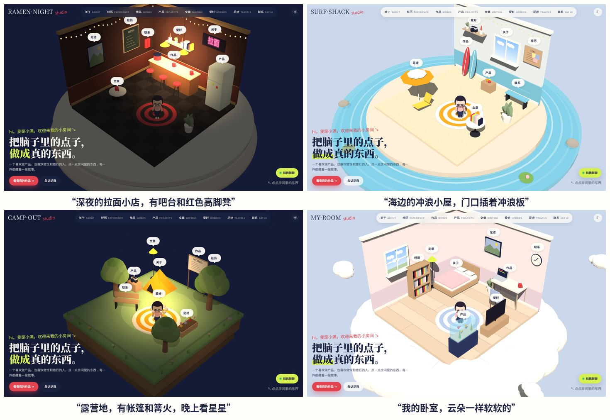

没想法也没关系，还有 5 个现成的房间可以直接用（右下角的“画室”也是描述出来的）：


**2. 房间下面放什么**：圆形小岛、草地、云朵、水面、岩石、展台，或者什么都不要。房间和底座可以随便搭配；你说“海边小屋”，AI 会自己配上水面。

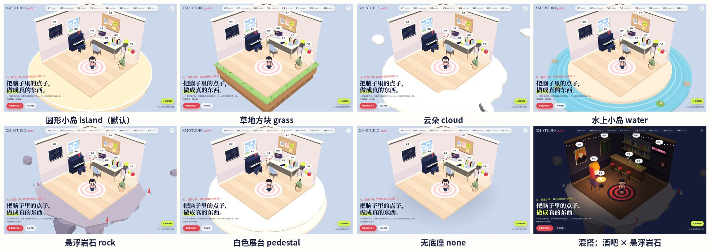

**3. 房间里的东西就是网站的板块**：鼠标放上去，东西会抬起来、上面的标签会变色；点一下，镜头飞过去，打开这个板块。

<table>
<tr>
<td width="50%"><br><sub>鼠标放上去：东西抬起，标签变色</sub></td>
<td width="50%">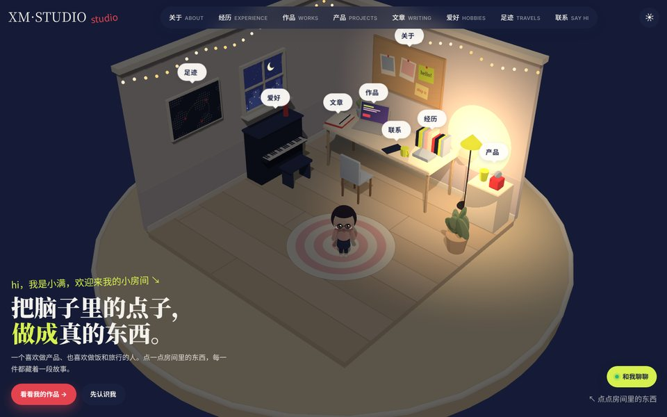<br><sub>右上角一键切换夜晚，台灯和串灯会亮</sub></td>
</tr>
</table>

还有：一个会眨眼、会转身的 Q 版小人（发型、衣服、配饰都能选）；右下角的“AI 分身”能替你回答访客的问题；手机上也能用。

---

## 🐣 小白上手：和 AI 聊完，它帮你做好、放照片、上线

> 全程不用写代码，也不用复制粘贴。你只需要：**回答问题 → 把照片拖给它 → 在弹出的页面点一次「Authorize」**。大约 15 分钟。

### 准备：下载这个项目

点这个页面右上角绿色的 **Code** 按钮 → **Download ZIP**。**压缩包先别解压**，等会儿直接拖给 AI。

### 第 1 步：把项目交给一个“会动手”的 AI，说一句话

“会动手”指的是它能运行代码、读写文件。**不用找提示词**：AI 会自己读项目里的说明，然后直接开始问你问题。

| 你用的是 | 怎么开始 |
|---|---|
| **Trae、CodeBuddy、Cursor、Qoder、Claude Code、Codex** 等编程工具 | 解压，用它打开这个文件夹，在对话框里说：**开始** |
| **Claude**（网页版 / 桌面版） | 在设置的 **Skills** 里上传这个 zip（只需一次），以后随时说：**帮我做个人网站** |
| **ChatGPT、Kimi（Agent 模式）** 等能上传文件、会跑代码的 AI | 把 zip 拖进对话框，说：**用这个压缩包帮我做网站** |

> 💡 AI 没有开始问你问题？把 `PROMPT.md` 里两行 `=====` 之间的文字发给它就行（备用办法）。

> ⚠️ Claude 一定要上传 zip。如果只在对话里点“保存技能”卡片，只会存下说明文字，模板不会带上。
>
> 编程工具能直接在你的电脑上开浏览器、读照片文件夹、上线，体验最顺；云端的 AI 最后会给你一个 `my-site.zip`。

### 第 2 步：像聊天一样回答问题

**用自己的话说**，不用想格式：

- 先聊聊你：直接贴简历或自我介绍；
- 再描述你想要的房间：比如“深夜的拉面小店，有吧台和红色高脚凳”；
- AI 会给你一份**布置方案**（房间里每件东西点开是什么），不满意就直接说“加一个鱼缸”“不要冰箱”“颜色再暖一点”。

哪一步没想法，就回“你定”，AI 会帮你挑。最后它会给你一张确认表，没问题回“好”。

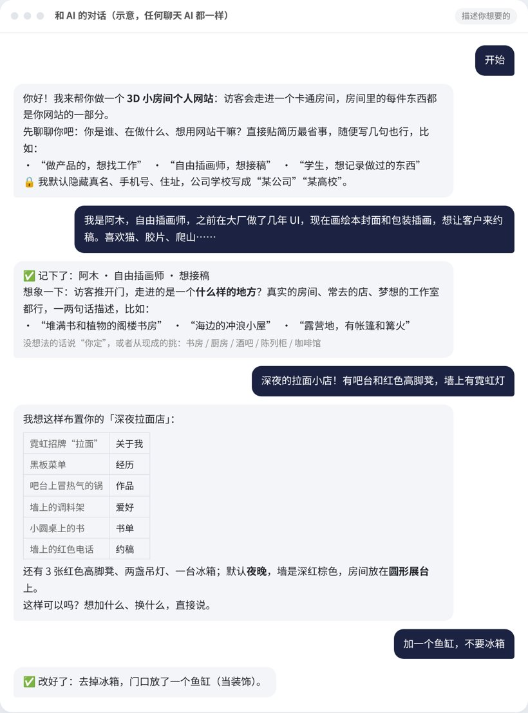

### 第 3 步：看效果、放照片（AI 来放）

AI 会自己生成网站、检查一遍，然后在浏览器里打开给你看。接着它会告诉你哪里可以放照片——**把照片文件夹拖进对话**（或直接把照片发给它）就行，它会列一张“哪张照片放哪儿”的表让你确认，然后自动压缩、放好。

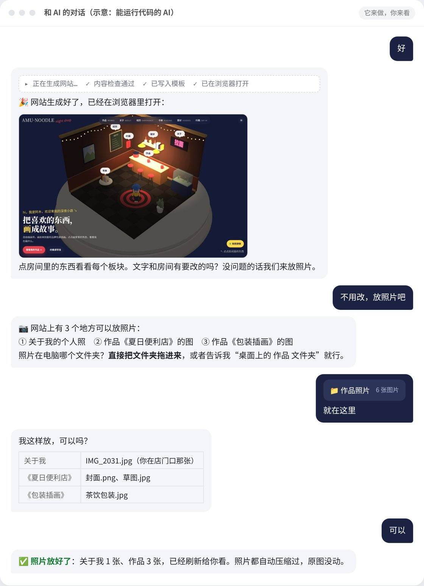

### 第 4 步：上线（AI 来跑，你点一下）

AI 会问你要不要放到网上：

- **先看看**：它直接给你一个临时网址，1 小时内有效，不用注册；
- **长期用**：浏览器会弹出 Netlify 的页面，没有账号就用邮箱或 GitHub 注册，然后点 **Authorize**，剩下的它来。

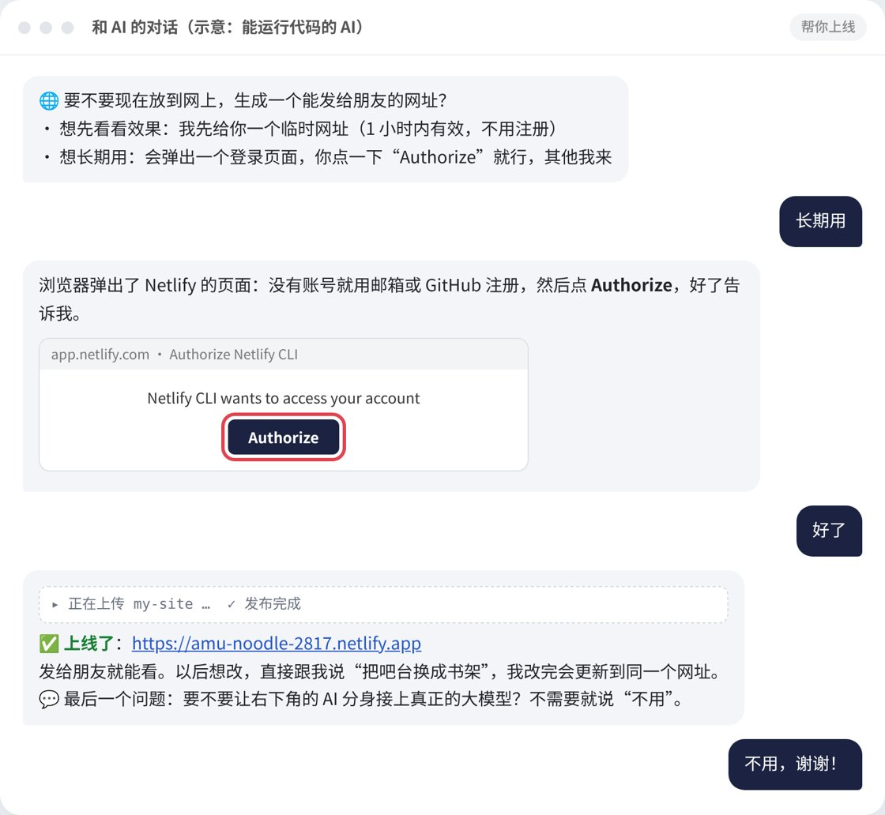

> 用的是云端 AI、它没法联网的话，它会把 `my-site.zip` 发给你：解压后，把文件夹拖进 **[app.netlify.com/drop](https://app.netlify.com/drop)** 就有网址了。

最后它还会问一次要不要让右下角的 AI 分身接上真正的大模型（需要一个大模型 API 密钥：它会帮你打开要用的页面，你只要把密钥粘贴到 Vercel 的设置里，**不用、也不要把密钥发到聊天里**），不需要就说“不用”。

🎉 完成！以后想改，回到同一个对话说“把吧台换成书架”“加一段经历”“换张照片”，它改完会帮你更新到同一个网址。

<table>
<tr>
<td width="50%"></td>
<td width="50%"></td>
</tr>
</table>

---

## 只能聊天的 AI 也能用（备用办法）

豆包、DeepSeek、通义千问、腾讯元宝、智谱清言等的普通对话模式不能运行代码，AI 会给你一段“网站内容代码”，你需要自己导入一次（3 步）：

1. **聊天**：解压项目，打开 `PROMPT.md`，复制两行 `=====` 之间的文字发给 AI，按上面第 2 步回答问题。确认后它会给你一段代码，点代码框右上角的 **「复制」**。

   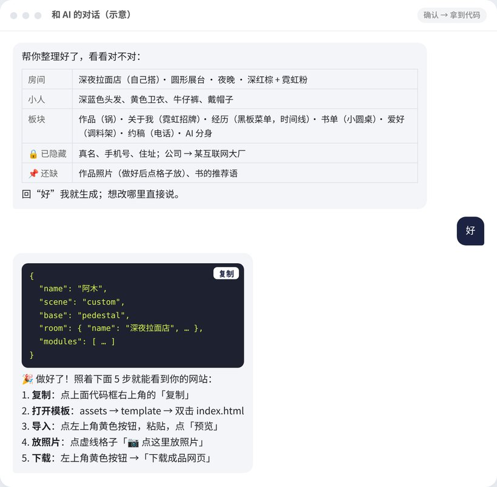

2. **打开模板**：在解压的文件夹里依次打开 **assets → template**，双击 **`index.html`**。

   

3. **一键导入**：点网页左上角的黄色按钮，再点红色的 **「📋 一键粘贴并预览」**，网页马上就变成你的了。（浏览器不让读剪贴板时，就在框里按 Ctrl+V / ⌘V，再点「预览」。）

   

   

<details>
<summary><b>放照片、下载成品、上线（只能聊天时）</b></summary>

- **放照片**：点开各个板块，看到虚线格子「📷 点这里放照片」就点一下，选电脑里的照片（会自动压缩）。建议文字都改满意了再放照片：之后如果又导入新内容，照片要重新放。

  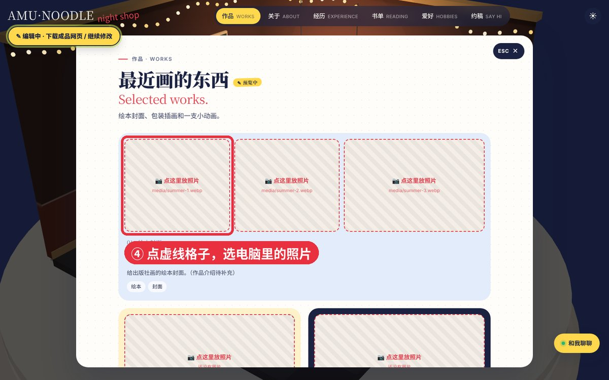

- **下载成品**：再点左上角黄色按钮 →「下载成品网页」，得到你自己的 `index.html`（照片已经在里面）。

  

- **上线**：新建一个文件夹，放进下载的 `index.html`，再把模板旁边的 `vendor` 文件夹复制进去，把这个文件夹拖进 [app.netlify.com/drop](https://app.netlify.com/drop)。
</details>

### 做成一个“点开就能用”的助手（扣子 Coze / 豆包智能体 / Kimi+ / GPTs / Gems / Dify）

想让朋友连提示词都不用复制：新建一个智能体，按 [`PROMPT.md` 末尾的「做成智能体」](PROMPT.md#做成智能体点开就开始) 填好人设、开场白和推荐问题，发布后把链接发给别人——对方点开，助手就会主动开始问问题。平台能运行代码时（比如开了代码插件），再把 `assets/template` 和 `assets/tools` 一起上传，它就能帮别人生成和上线。

---

## 网站里有哪些板块

板块可以删、可以加、可以改名，每个都有几种样子可选（AI 会问你）。

| 板块 | 可选的样子 | 需要准备什么 |
|---|---|---|
| 🙋 关于我 | 照片 + 贴纸 + 小档案 ／ 一封信 | 一段自我介绍，有照片更好 |
| 📖 经历 | 翻页书 ／ 时间线 ／ 卡片 | 每段经历：在哪、什么时候、做了什么 |
| 🎨 作品集 | 拼贴卡片（图片、图集、视频） | 作品名、一句话介绍、照片 |
| 🚀 产品 / 项目 | 叠在一起的大卡片 ／ 网格 | 名称、介绍、链接 |
| ✍️ 文章 | 列表 + 阅读页 | 标题和正文 |
| 🎹 爱好 | 彩色卡片，每张都能玩：小钢琴、抽创作灵感、打字机、登山、城市邮戳、好奇心雷达 | 你的爱好 + 一句话 |
| 🗺️ 去过的地方 | 地图 + 明信片 ／ 相册 | 城市名（位置 AI 会补），有照片更好 |
| 💌 联系方式 | 自动打字的信纸 ／ 卡片 | 邮箱、社交账号 |
| 💬 AI 分身 | 右下角聊天窗口 | 不用准备，AI 根据你的资料写好问答 |
| ✨ 自定义 | 文字 + 卡片 + 图片 | 任何东西：书单、摄影、播客…… |

<table>
<tr>
<td width="50%"><br><sub>🙋 关于我</sub></td>
<td width="50%"><br><sub>📖 经历 · 翻页书</sub></td>
</tr>
<tr>
<td>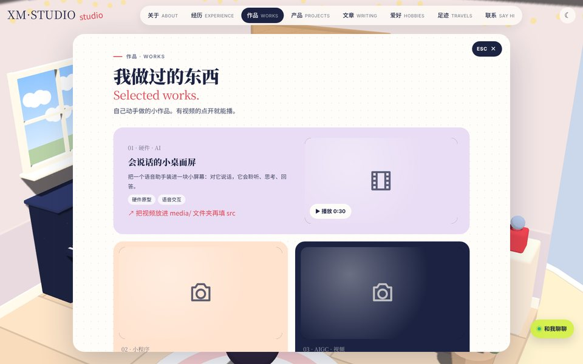<br><sub>🎨 作品集</sub></td>
<td><br><sub>🚀 产品 · 叠卡（← → 键切换）</sub></td>
</tr>
<tr>
<td><br><sub>🎹 爱好 · 能弹的小钢琴</sub></td>
<td>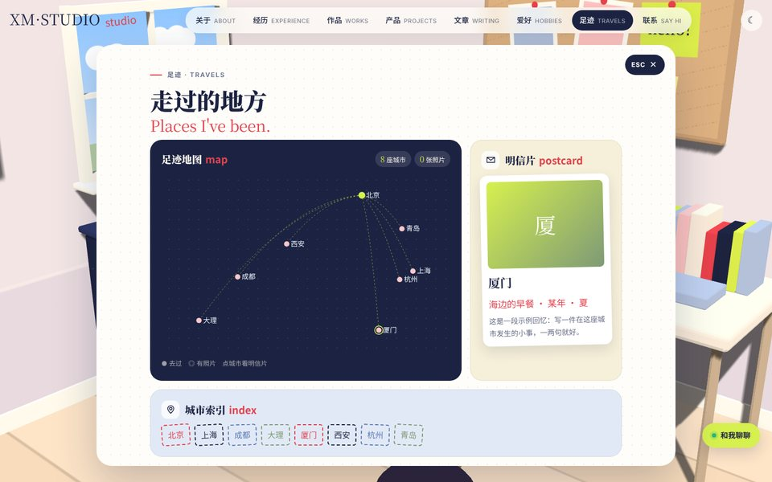<br><sub>🗺️ 去过的地方 · 地图 + 明信片</sub></td>
</tr>
<tr>
<td>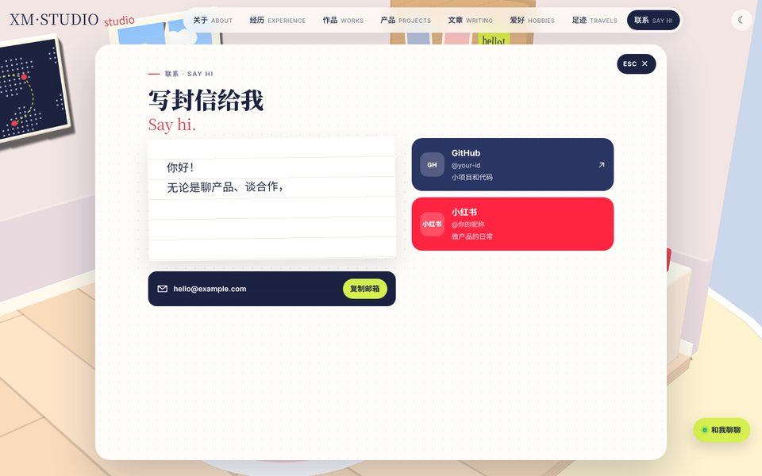<br><sub>💌 联系方式 · 一键复制邮箱</sub></td>
<td>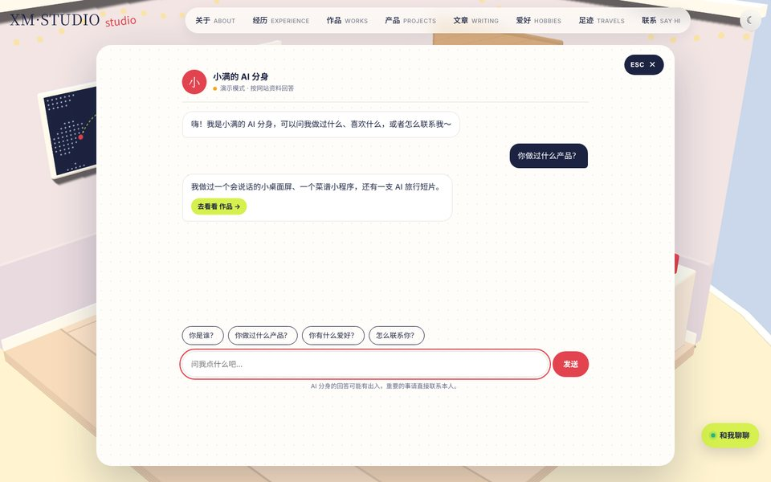<br><sub>💬 AI 分身 · 回答后能跳到对应板块</sub></td>
</tr>
<tr>
<td><br><sub>✍️ 文章阅读页</sub></td>
<td>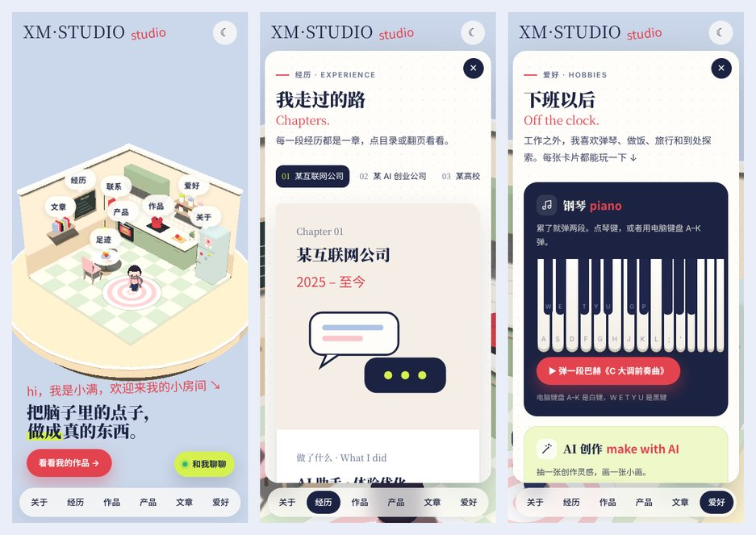<br><sub>📱 手机版</sub></td>
</tr>
</table>

---

## 常见问题

<details>
<summary><b>AI 还是让我复制代码、点黄色按钮？</b></summary>

说明它不能运行代码，或者没读到配置步骤。可以直接对它说：“请你自己运行 `assets/tools/build_site.py` 生成网站，再帮我放照片、上线，不要让我手动操作。”如果它说做不到，就换上面第 1 步表格里的 AI，或者按「只能聊天的 AI 也能用」的 3 步来。
</details>

<details>
<summary><b>（只能聊天时）代码粘贴后提示“格式不对”？</b></summary>

把提示原样发回给 AI，说“请输出修正后的完整代码”。常见原因是代码没复制全（开头要是 `{`，结尾要是 `}`），或者 AI 在代码里加了注释。
</details>

<details>
<summary><b>我描述的东西，AI 搭不出来一模一样的？</b></summary>

房间是用现成的“积木”拼出来的（大约 45 种：家具、电器、乐器、植物、帐篷、篝火、冲浪板……）。没有的东西 AI 会用最像的代替，并在布置方案里告诉你，你可以让它换。想要更多积木，欢迎提 Issue。
</details>

<details>
<summary><b>照片很多 / 想放视频？</b></summary>

交给会动手的 AI 放就没有数量限制：把照片、视频（最好是 mp4、8MB 以内）一起拖给它，它会压缩好放进网站文件夹。只能聊天时，网页里点格子放照片最多存约 5MB（20–30 张），视频不能这样放。
</details>

<details>
<summary><b>网站做好了，以后还想加照片？</b></summary>

回到原来的对话，把照片发给 AI 说放哪儿，它会重新生成并更新网址。只能聊天时：用浏览器打开你的 `index.html`，在网址最后加上 `?edit` 回车，点“📷 点这里放照片”的格子，再点黄色按钮 →「下载成品网页」，用新文件替换旧的。
</details>

<details>
<summary><b>打开后只有卡片，没有 3D 房间？</b></summary>

说明浏览器不支持 3D，或者 3D 引擎没加载到。确认 `vendor` 文件夹和 `index.html` 放在一起；或者换最新版的 Chrome / Edge / Safari 试试。网站内容不受影响，只是换成了卡片样式。
</details>

<details>
<summary><b>别人打开我的网站很慢 / 打不开？</b></summary>

Netlify、Vercel 这类国外服务在国内有时不稳定。访客主要在国内的话，可以用腾讯云、阿里云等国内的静态网站托管（需要备案的域名）。
</details>

<details>
<summary><b>能做英文网站吗？</b></summary>

可以，跟 AI 说“全部用英文”就行。
</details>

---

## 进阶用法

### 网址小技巧

在浏览器地址栏网址最后加上这些，可以快速预览：

| 加在网址后面 | 作用 |
|---|---|
| `?scene=kitchen` | 换房间：`studio` 工作台、`kitchen` 厨房、`bar` 酒吧、`cabinet` 陈列柜、`cafe` 咖啡馆 |
| `?base=cloud` | 换底座：`island` 小岛、`grass` 草地、`cloud` 云朵、`water` 水面、`rock` 岩石、`pedestal` 展台、`none` 无 |
| `?open=hobbies` | 直接打开某个板块 |
| `?edit` | 编辑模式（只能聊天时用）：出现黄色按钮，可以导入内容、放照片、下载成品 |

可以组合使用，比如 `index.html?scene=bar&base=rock`。

### 自己改内容（不经过 AI）

网站的所有内容都在一份 `site.json` 里（会动手的 AI 会把它放在你的网站文件夹旁边）。改完运行 `python3 assets/tools/build_site.py site.json --out my-site` 重新生成即可，照片位置直接写照片在电脑上的路径。没有 site.json 时：内容在 `index.html` 里一段叫 `site-content` 的代码中，打开 `index.html?edit` → 点黄色按钮 → 在框里直接改 → 预览 → 下载成品。每一项能填什么，见 [`references/modules.md`](references/modules.md)；根据描述搭房间的方法和全部“积木”见 [`references/scenes.md`](references/scenes.md)。

### 上线的几种方式

| 方式 | 难度 | 做法 |
|---|---|---|
| Netlify Drop | ⭐ 最简单 | 打开 app.netlify.com/drop，把网站文件夹拖进去 |
| GitHub Pages | ⭐⭐ | 新建仓库，上传文件，Settings → Pages 选 `main` 分支 |
| Vercel | ⭐⭐ | 在网站文件夹里运行 `npx vercel --prod`；想让 AI 分身真的会聊天选这个 |
| 国内静态托管 | ⭐⭐⭐ | 腾讯云、阿里云、七牛等，绑定备案域名，国内访问最快 |

> 这个项目本身放到 GitHub 后，也可以在 Settings → Pages 里开启，在线演示地址是 `https://你的用户名.github.io/仓库名/assets/template/`。

### 让 AI 分身真的会聊天

默认的 AI 分身按写好的问答回答，不需要服务器。想让它接上真正的大模型（DeepSeek、Kimi、通义千问、智谱、豆包等都支持）：用 Vercel 上线，把 `assets/template` 里的 `api`、`knowledge` 文件夹和 `vercel.json` 一起放进网站文件夹，在 Vercel 后台填一个 `LLM_API_KEY`。详细步骤见 [`references/deploy.md`](references/deploy.md)。

---

## 隐私说明

个人网站是公开的，**别人“查看网页源代码”也能看到所有内容**。所以 AI 会：

- 在收集资料**之前**先问你：真名、公司、学校、具体数字、城市要不要隐藏（默认隐藏真名、手机号、住址，公司学校写成“某公司”“某高校”）；
- **永远不放**手机号、身份证号、住址、证件和工牌照片、薪资、公司内部数据、别人的照片和名字；
- 生成前在确认表里列出“已隐藏”的内容。

照片里的校徽、工牌、电脑屏幕、门牌请自己再看一眼。完整规则见 [`references/privacy.md`](references/privacy.md)。本项目里的示例人物“小满”“阿木”都是虚构的。

---

## 文件夹里都是什么

```
3d-room-website/
├── README.md                你正在看的说明
├── AGENTS.md                给 AI 的开场说明：用户一开口就带他做网站（编程工具会自动读取；CLAUDE.md、GEMINI.md、.trae/、.claude/ 都指向它）
├── PROMPT.md                备用：发给只能聊天的 AI 的提示词
├── SKILL.md                 给 Claude / 编程工具的说明
├── assets/
│   ├── tools/build_site.py  给 AI 用：一条命令生成成品、放好照片
│   ├── template/
│   │   ├── index.html       ⭐ 网站模板（双击打开）
│   │   ├── vendor/          3D 引擎，上线时要一起带上
│   │   ├── media/           放视频（照片可以直接在网页里点格子放）
│   │   ├── api/、knowledge/、vercel.json   可选：让 AI 分身接真模型
│   └── site.example.json    完整的内容示例
├── references/              给 AI 看的详细规则（问答话术、生成与引导配置、房间、板块、隐私、设计、上线）
└── docs/screenshots/        这份说明用的截图
```

---

## 参与贡献

欢迎提 Issue 和 PR：

- 在不同 AI 里试用的反馈（哪一步卡住了、哪句话看不懂）——这对小白体验最重要；
- 新的“积木”（更多能摆进房间的东西）、房间、底座、爱好小游戏、板块样子。

技术说明：整个网站是一个 HTML 文件，没有构建步骤；3D 用 three.js r147，所有家具和小人都是代码拼出来的。现成房间在 `SCENES`，底座在 `buildBase`，“积木”（描述搭房间用的物件）在 `PROP_KINDS`，板块在 `RENDER` / `INIT`，爱好小游戏在 `WIDGETS`。改完请在电脑（1440×900）和手机（390×844）两个尺寸下检查，并确认浏览器控制台没有报错。交互上踩过的坑写在 [`references/design.md`](references/design.md)。

---

## 许可与致谢

- 本项目：许可证见仓库根目录的 `LICENSE` 文件。
- [three.js](https://github.com/mrdoob/three.js) r147，MIT 许可（见 `assets/template/vendor/LICENSE-three.txt`）。
- 小钢琴自动演奏的是巴赫《C 大调前奏曲》BWV 846（公有领域）。
- 字体：Gloock、Caveat、Instrument Sans、Noto Serif SC、站酷快乐体（开源字体，通过 Google Fonts 加载）。
