<div align="center">

# 🏠 3D 小房间个人网站

**不用写代码，和 AI 聊几句，就能做一个“走进去逛”的 3D 个人网站**

选一个你熟悉的地方——书房、厨房、酒吧、咖啡馆……房间里的每件东西都是网站的一个板块，点一下就能看。

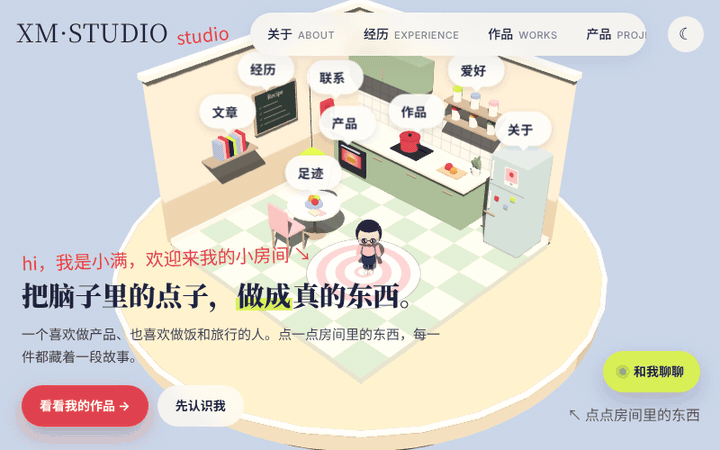

*An AI skill + single-file template that turns a short chat with any AI (Claude, Kimi, Doubao, DeepSeek, ChatGPT…) into an interactive 3D "room" personal website. Docs are in Chinese.*

</div>

---

## 目录

- [能做出什么样的网站](#能做出什么样的网站)
- [🐣 小白上手：7 步做出你的网站](#-小白上手7-步做出你的网站)
- [用 Claude 或编程工具（更省事）](#用-claude-或编程工具更省事)
- [网站里有哪些板块](#网站里有哪些板块)
- [常见问题](#常见问题)
- [进阶用法](#进阶用法)
- [隐私说明](#隐私说明)
- [文件夹里都是什么](#文件夹里都是什么)
- [参与贡献](#参与贡献)
- [许可与致谢](#许可与致谢)

---

## 能做出什么样的网站

**1. 先选一个房间**：5 个现成的，也可以让 AI 搭一个你熟悉的地方（右下角的“画室”就是这样搭出来的）。

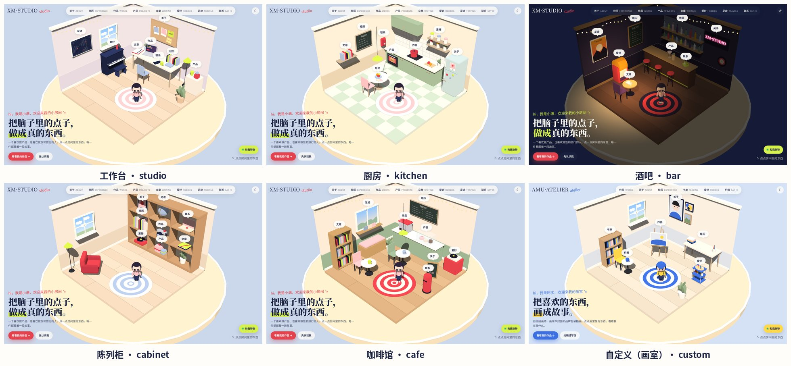

**2. 再选房间下面的底座**：圆形小岛、草地、云朵、水面、岩石、展台，或者什么都不要。房间和底座可以随便搭配。


**3. 房间里的东西就是网站的板块**：鼠标放上去，东西会抬起来、上面的标签会变色；点一下，镜头飞过去，打开这个板块。

<table>
<tr>
<td width="50%">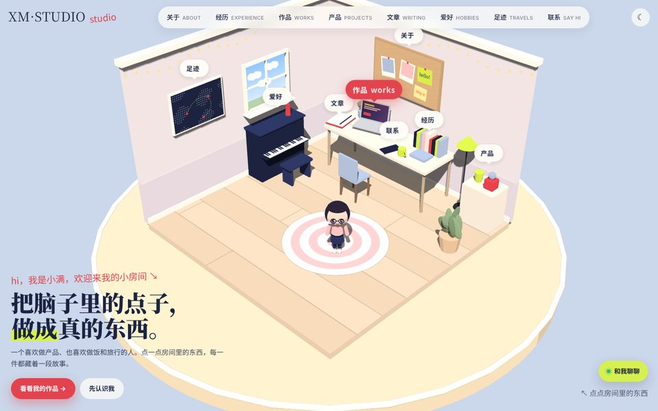<br><sub>鼠标放上去：东西抬起，标签变色</sub></td>
<td width="50%"><br><sub>右上角一键切换夜晚，台灯和串灯会亮</sub></td>
</tr>
</table>

还有：一个会眨眼、会转身的 Q 版小人（发型、衣服、配饰都能选）；右下角的“AI 分身”能替你回答访客的问题；手机上也能用。

---

## 🐣 小白上手：7 步做出你的网站

> 全程不用写代码。你需要：一个能聊天的 AI（Kimi、豆包、DeepSeek、通义千问、腾讯元宝、智谱清言、ChatGPT、Gemini 都行）+ 一个浏览器。大约 15 分钟。

### 准备：下载这个项目

点这个页面右上角绿色的 **Code** 按钮 → **Download ZIP**，下载后**解压**。

### 第 1 步：把提示词发给 AI

打开解压后文件夹里的 **`PROMPT.md`**（用记事本或任何文本编辑器都能打开），复制两行 `=====` 之间的全部文字，发给 AI 作为第一条消息。

然后跟着它的问题回答就行，**大部分问题回一个数字**。第一次建议选 **⚡ 快速模式**：贴一段自我介绍（简历也行），再选房间和底座，一共 3 个问题。

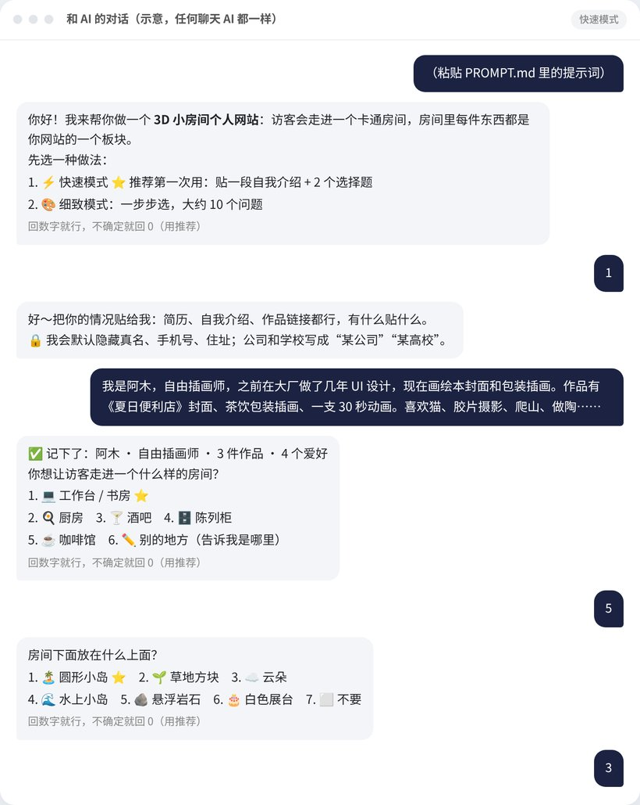

### 第 2 步：确认，拿到“网站内容代码”

AI 会先给你一张表核对（用了什么房间、有哪些板块、帮你隐藏了哪些隐私、还缺什么）。没问题就回“好”，它会给你一段代码，**点代码框右上角的「复制」**。


> 看不懂代码没关系，你只需要复制它。

### 第 3 步：打开模板

在解压的文件夹里依次打开 **assets → template**，**双击 `index.html`**，它会在浏览器里打开一个示例网站。

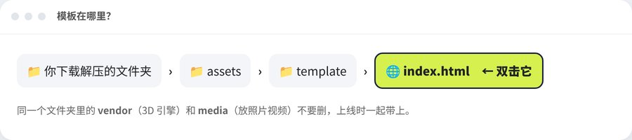

点网页**左上角的黄色按钮**「✎ 这是示例内容 · 导入我的内容」：

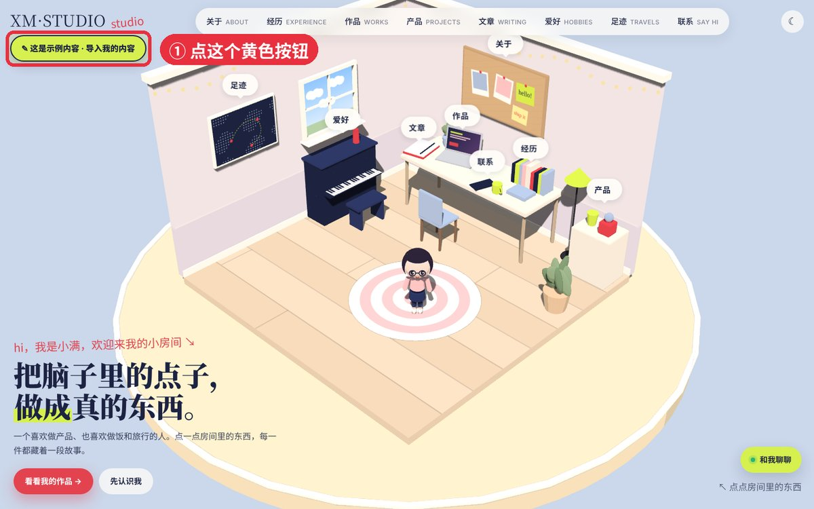

### 第 4 步：粘贴，预览

把第 2 步复制的内容**粘贴**到框里，点红色的 **「预览」**：

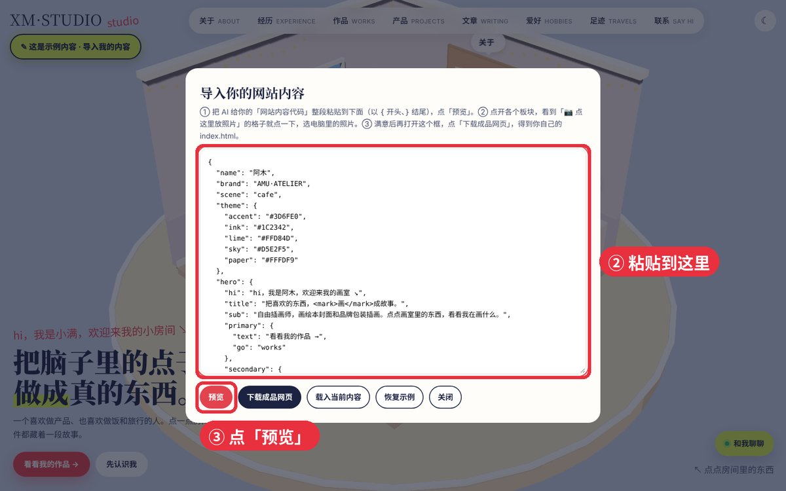

网页马上就变成你的了：

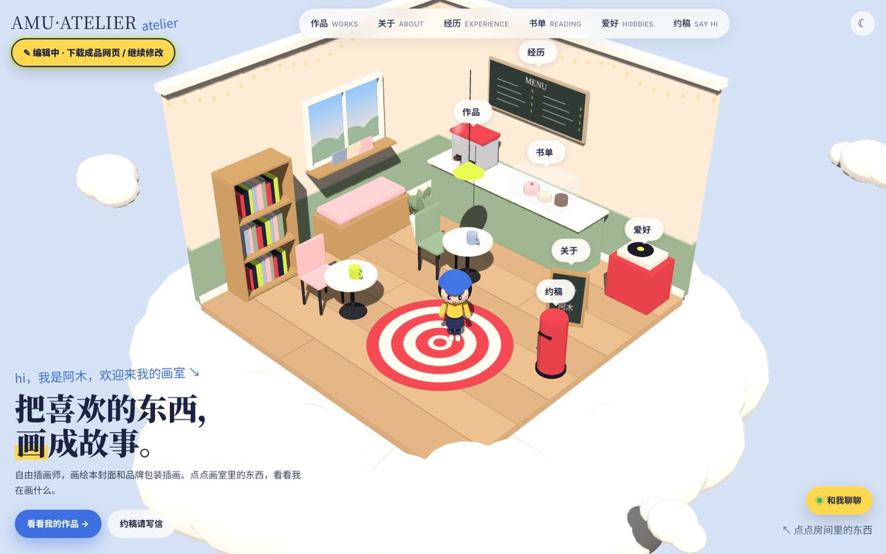

### 第 5 步：放照片

点房间里的东西打开各个板块。看到**虚线格子「📷 点这里放照片」**就点一下，从电脑里选照片（会自动压缩，不用管大小和文件名）：


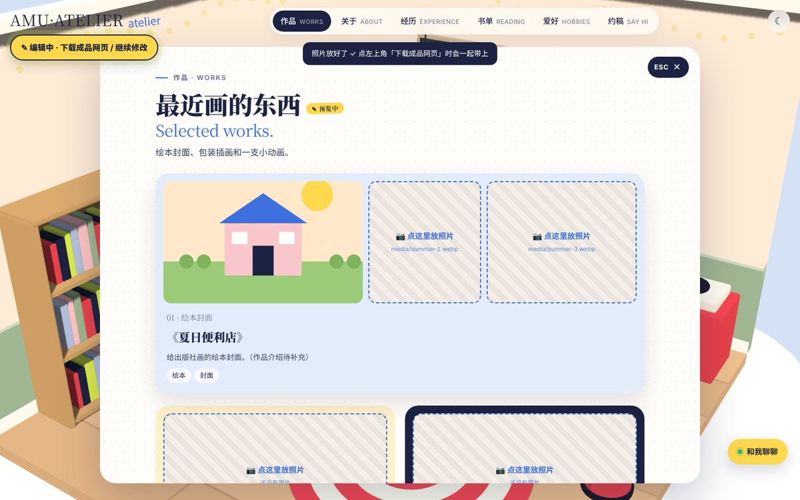

> 💡 建议**文字都改满意了再放照片**：如果之后又从 AI 那里导入新的内容，已经放好的照片需要重新放一次。

### 第 6 步：下载成品

再点左上角的黄色按钮，点 **「下载成品网页」**，你会得到一个新的 `index.html`——这就是你的网站，照片已经在里面了。

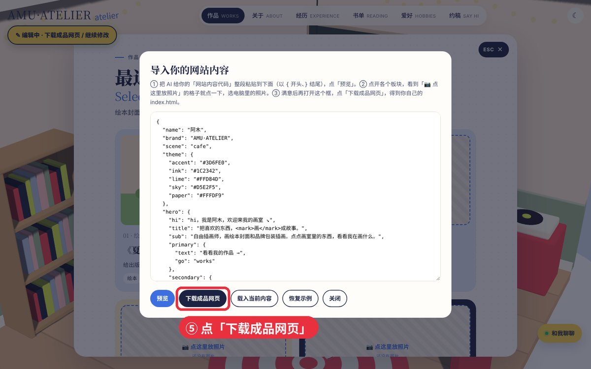

### 第 7 步：上线，让别人也能看到

1. 新建一个文件夹（比如叫 `my-site`），把刚下载的 **`index.html`** 放进去；
2. 再把模板旁边的 **`vendor`** 文件夹复制进去（里面是 3D 引擎）；
3. 打开 **[app.netlify.com/drop](https://app.netlify.com/drop)**，把 `my-site` 文件夹**拖进网页**，等几秒就会给你一个网址，发给朋友就能看。

> 想长期保存、改名字，注册一个免费 Netlify 账号即可。其他上线方式见 [进阶用法](#上线的几种方式)。

🎉 完成！以后想改：回到和 AI 的对话说“把经历改成时间线”“主色换成绿色”，它会给你新的代码，再做一遍第 4–6 步就行。

<table>
<tr>
<td width="50%">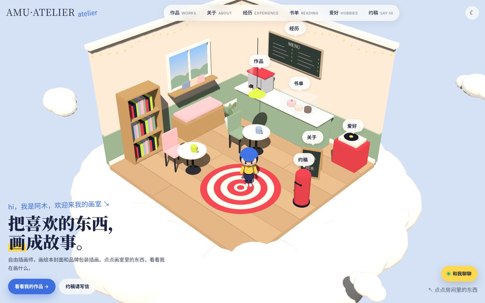</td>
<td width="50%">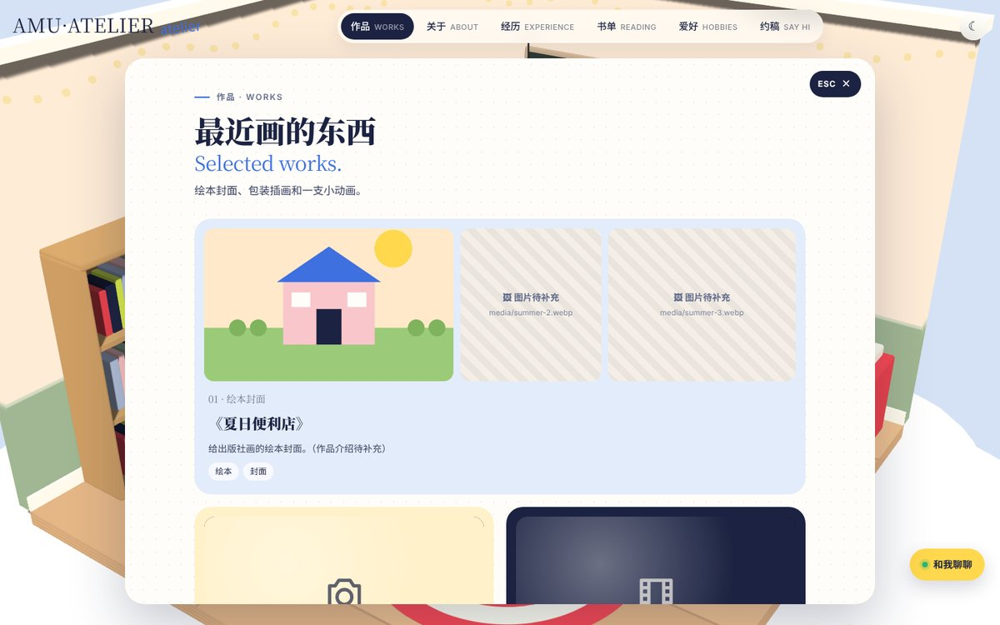</td>
</tr>
</table>

---

## 用 Claude 或编程工具（更省事）

这些工具能直接生成文件，所以**不用复制粘贴**，最后直接给你一个做好的网站文件夹。

### Claude

1. 下载这个项目，把整个文件夹压缩成 zip（`docs` 文件夹只是这份说明用的截图，可以删掉再压缩）。
2. 打开 Claude 的设置，找到 **Skills**，**上传这个 zip**。
   > ⚠️ 一定要上传 zip。如果只在对话里点“保存技能”卡片，只会存下 `SKILL.md`，模板不会带上。
3. 对 Claude 说：**帮我做一个 3D 小房间个人网站**。照片可以直接发给它，它会帮你放好。

### Claude Code / Cursor / Trae / Qoder / CodeBuddy / Codex 等编程工具

把这个项目放进你的工作文件夹，然后说：

```
按 3d-room-website/SKILL.md 的流程，帮我做一个 3D 小房间个人网站，成品放到 my-site 文件夹
```

### 扣子 Coze / 豆包智能体 / Kimi+ / GPTs / Gems / Dify（做成一个助手分享给别人）

新建智能体，把 `PROMPT.md` 里的提示词粘贴到“人设与指令”，可以的话把 `assets/site.example.json` 和 `references` 文件夹里的文档上传为知识库。别人和它聊完，按上面小白教程的第 3–7 步操作即可。

---

## 网站里有哪些板块

板块可以删、可以加、可以改名，每个都有几种样子可选（AI 会问你）。

| 板块 | 可选的样子 | 需要准备什么 |
|---|---|---|
| 🙋 关于我 | 照片 + 贴纸 + 小档案 ／ 一封信 | 一段自我介绍，有照片更好 |
| 📖 经历 | 翻页书 ／ 时间线 ／ 卡片 | 每段经历：在哪、什么时候、做了什么 |
| 🎨 作品集 | 拼贴卡片（图片、图集、视频） | 作品名、一句话介绍、照片 |
| 🚀 产品 / 项目 | 叠在一起的大卡片 ／ 网格 | 名称、介绍、链接 |
| ✍️ 文章 | 列表 + 阅读页 | 标题和正文 |
| 🎹 爱好 | 彩色卡片，每张都能玩：小钢琴、抽创作灵感、打字机、登山、城市邮戳、好奇心雷达 | 你的爱好 + 一句话 |
| 🗺️ 去过的地方 | 地图 + 明信片 ／ 相册 | 城市名（位置 AI 会补），有照片更好 |
| 💌 联系方式 | 自动打字的信纸 ／ 卡片 | 邮箱、社交账号 |
| 💬 AI 分身 | 右下角聊天窗口 | 不用准备，AI 根据你的资料写好问答 |
| ✨ 自定义 | 文字 + 卡片 + 图片 | 任何东西：书单、摄影、播客…… |

<table>
<tr>
<td width="50%">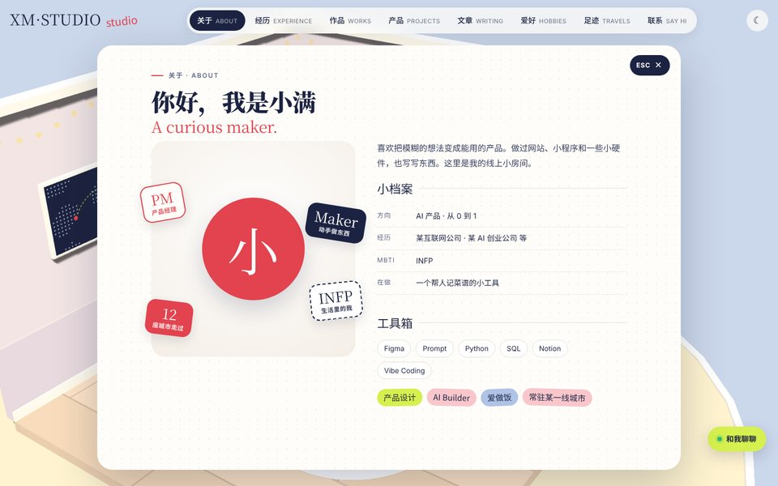<br><sub>🙋 关于我</sub></td>
<td width="50%">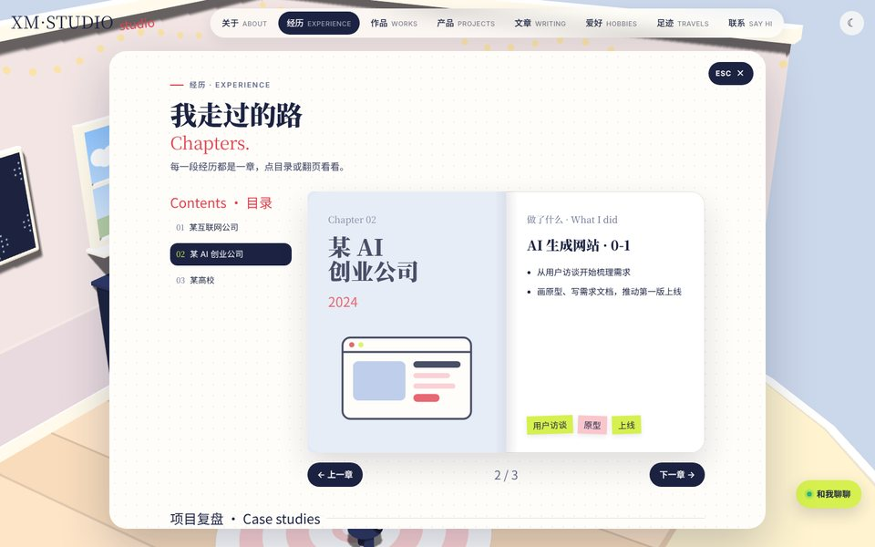<br><sub>📖 经历 · 翻页书</sub></td>
</tr>
<tr>
<td><br><sub>🎨 作品集</sub></td>
<td>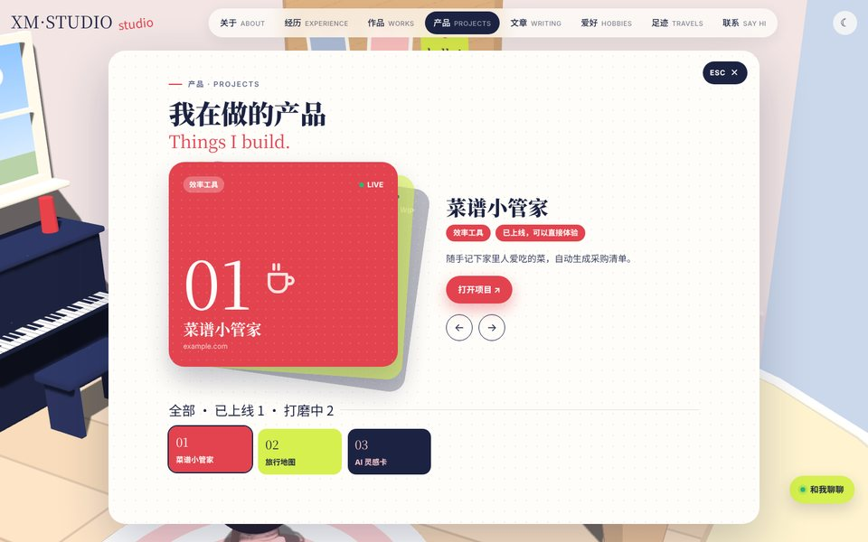<br><sub>🚀 产品 · 叠卡（← → 键切换）</sub></td>
</tr>
<tr>
<td>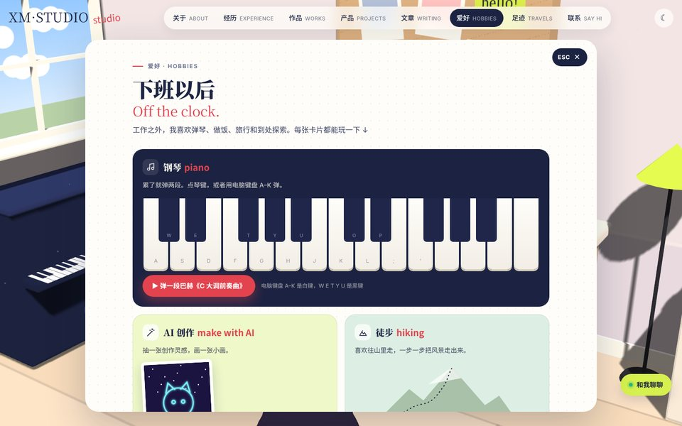<br><sub>🎹 爱好 · 能弹的小钢琴</sub></td>
<td><br><sub>🗺️ 去过的地方 · 地图 + 明信片</sub></td>
</tr>
<tr>
<td><br><sub>💌 联系方式 · 一键复制邮箱</sub></td>
<td><br><sub>💬 AI 分身 · 回答后能跳到对应板块</sub></td>
</tr>
<tr>
<td>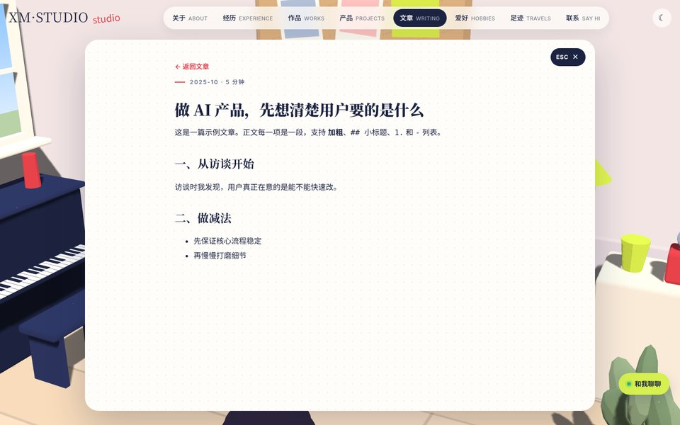<br><sub>✍️ 文章阅读页</sub></td>
<td><br><sub>📱 手机版</sub></td>
</tr>
</table>

---

## 常见问题

<details>
<summary><b>AI 给的代码粘贴后提示“格式不对”？</b></summary>

把提示原样发回给 AI，说“请输出修正后的完整代码”。常见原因是代码没复制全（开头要是 `{`，结尾要是 `}`），或者 AI 在代码里加了注释。
</details>

<details>
<summary><b>我想要的房间不在列表里？</b></summary>

选“✏️ 别的地方”，告诉 AI 是哪里（画室、录音棚、宿舍、图书馆……）。它会先列出准备放哪些东西、各对应什么板块，你同意后再做。
</details>

<details>
<summary><b>照片太多，提示“浏览器存不下了”？</b></summary>

浏览器能临时保存的照片大约 5MB（压缩后差不多 20–30 张）。超过的话：把照片放进模板旁边的 `media` 文件夹，告诉 AI 每张照片的文件名和放在哪，让它写进代码里。
</details>

<details>
<summary><b>视频怎么放？</b></summary>

视频比较大，不能用点格子的方式放。把视频（mp4 格式，最好 5MB 以内）放进 `media` 文件夹，告诉 AI 文件名就行。上线时 `media` 文件夹也要一起带上。
</details>

<details>
<summary><b>网站做好了，以后还想加照片？</b></summary>

用浏览器打开你的 `index.html`，在地址栏网址的最后加上 `?edit` 回车，就会出现黄色按钮和“点这里放照片”的格子。放好后点黄色按钮 →「下载成品网页」，用新文件替换旧的。
</details>

<details>
<summary><b>打开后只有卡片，没有 3D 房间？</b></summary>

说明浏览器不支持 3D，或者 3D 引擎没加载到。确认 `vendor` 文件夹和 `index.html` 放在一起；或者换最新版的 Chrome / Edge / Safari 试试。网站内容不受影响，只是换成了卡片样式。
</details>

<details>
<summary><b>别人打开我的网站很慢 / 打不开？</b></summary>

Netlify、Vercel 这类国外服务在国内有时不稳定。访客主要在国内的话，可以用腾讯云、阿里云等国内的静态网站托管（需要备案的域名）。
</details>

<details>
<summary><b>能做英文网站吗？</b></summary>

可以，跟 AI 说“全部用英文”就行。
</details>

---

## 进阶用法

### 网址小技巧

在浏览器地址栏网址最后加上这些，可以快速预览：

| 加在网址后面 | 作用 |
|---|---|
| `?scene=kitchen` | 换房间：`studio` 工作台、`kitchen` 厨房、`bar` 酒吧、`cabinet` 陈列柜、`cafe` 咖啡馆 |
| `?base=cloud` | 换底座：`island` 小岛、`grass` 草地、`cloud` 云朵、`water` 水面、`rock` 岩石、`pedestal` 展台、`none` 无 |
| `?open=hobbies` | 直接打开某个板块 |
| `?edit` | 编辑模式：出现黄色按钮，可以导入内容、放照片、下载成品 |

可以组合使用，比如 `index.html?scene=bar&base=rock`。

### 自己改内容（不经过 AI）

网站的所有内容都在 `index.html` 里一段叫 `site-content` 的代码中。最简单的改法：打开 `index.html?edit` → 点黄色按钮 → 在框里直接改 → 预览 → 下载成品。每一项能填什么，见 [`references/modules.md`](references/modules.md)；自己搭房间的方法见 [`references/scenes.md`](references/scenes.md)。

### 上线的几种方式

| 方式 | 难度 | 做法 |
|---|---|---|
| Netlify Drop | ⭐ 最简单 | 打开 app.netlify.com/drop，把网站文件夹拖进去 |
| GitHub Pages | ⭐⭐ | 新建仓库，上传文件，Settings → Pages 选 `main` 分支 |
| Vercel | ⭐⭐ | 在网站文件夹里运行 `npx vercel --prod`；想让 AI 分身真的会聊天选这个 |
| 国内静态托管 | ⭐⭐⭐ | 腾讯云、阿里云、七牛等，绑定备案域名，国内访问最快 |

> 这个项目本身放到 GitHub 后，也可以在 Settings → Pages 里开启，在线演示地址是 `https://你的用户名.github.io/仓库名/assets/template/`。

### 让 AI 分身真的会聊天

默认的 AI 分身按写好的问答回答，不需要服务器。想让它接上真正的大模型（DeepSeek、Kimi、通义千问、智谱、豆包等都支持）：用 Vercel 上线，把 `assets/template` 里的 `api`、`knowledge` 文件夹和 `vercel.json` 一起放进网站文件夹，在 Vercel 后台填一个 `LLM_API_KEY`。详细步骤见 [`references/deploy.md`](references/deploy.md)。

---

## 隐私说明

个人网站是公开的，**别人“查看网页源代码”也能看到所有内容**。所以 AI 会：

- 在收集资料**之前**先问你：真名、公司、学校、具体数字、城市要不要隐藏（快速模式默认隐藏真名、手机号、住址，公司学校写成“某公司”“某高校”）；
- **永远不放**手机号、身份证号、住址、证件和工牌照片、薪资、公司内部数据、别人的照片和名字；
- 生成前在确认表里列出“已隐藏”的内容。

照片里的校徽、工牌、电脑屏幕、门牌请自己再看一眼。完整规则见 [`references/privacy.md`](references/privacy.md)。本项目里的示例人物“小满”“阿木”都是虚构的。

---

## 文件夹里都是什么

```
3d-room-website/
├── README.md                你正在看的说明
├── PROMPT.md                ⭐ 发给任何聊天 AI 的提示词
├── SKILL.md                 给 Claude / 编程工具的说明
├── assets/
│   ├── template/
│   │   ├── index.html       ⭐ 网站模板（双击打开）
│   │   ├── vendor/          3D 引擎，上线时要一起带上
│   │   ├── media/           放视频（照片可以直接在网页里点格子放）
│   │   ├── api/、knowledge/、vercel.json   可选：让 AI 分身接真模型
│   └── site.example.json    完整的内容示例
├── references/              给 AI 看的详细规则（问答话术、房间、板块、隐私、设计、上线）
└── docs/screenshots/        这份说明用的截图
```

---

## 参与贡献

欢迎提 Issue 和 PR：

- 在不同 AI 里试用的反馈（哪一步卡住了、哪句话看不懂）——这对小白体验最重要；
- 新的房间、底座、房间里的小物件、爱好小游戏、板块样子。

技术说明：整个网站是一个 HTML 文件，没有构建步骤；3D 用 three.js r147，所有家具和小人都是代码拼出来的。房间在 `SCENES`，底座在 `buildBase`，可摆放的物件在 `PROP_KINDS`，板块在 `RENDER` / `INIT`，爱好小游戏在 `WIDGETS`。改完请在电脑（1440×900）和手机（390×844）两个尺寸下检查，并确认浏览器控制台没有报错。交互上踩过的坑写在 [`references/design.md`](references/design.md)。

---

## 许可与致谢

- 本项目：许可证见仓库根目录的 `LICENSE` 文件。
- [three.js](https://github.com/mrdoob/three.js) r147，MIT 许可（见 `assets/template/vendor/LICENSE-three.txt`）。
- 小钢琴自动演奏的是巴赫《C 大调前奏曲》BWV 846（公有领域）。
- 字体：Gloock、Caveat、Instrument Sans、Noto Serif SC、站酷快乐体（开源字体，通过 Google Fonts 加载）。
